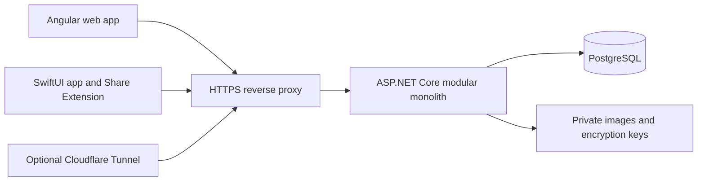

# Recipe Manager

**Your household’s recipes, meals and shopping — on your own server.**

Recipe Manager combines a shared recipe library, weekly meal planner, explicit leftovers and editable shopping lists. Use the responsive Angular web app or the native SwiftUI iPhone app; both use the same household accounts and ASP.NET Core backend.

> **Development status:** the core workflows are implemented, but final accessibility, native parity and cross-client performance checks remain open. This is not yet a stable public release. See the [release checklist](docs/release-checklist.md) for current evidence and limitations.

## What it does

- **Keep your recipes organised.** Create, edit, duplicate, favourite and archive recipes; organise them with shared collections and tags.
- **Work with real ingredients.** Separate quantities, units, names and preparation notes; household autocomplete and aliases; Australian and US cup/spoon standards; serving previews without changing the recipe.
- **Import and review.** Enter recipes manually, extract supported recipe websites, or optionally structure pasted text using a configured AI provider. Review imports before saving. The iOS Share Extension captures URLs or text offered by other apps.
- **Plan cooking and leftovers.** Track portions to prepare separately from portions to eat. Reserve leftovers explicitly, record actual amounts when useful, and resolve allocation conflicts.
- **Shop together.** Generate lists from meals or selected recipes, consolidate compatible ingredients, keep unspecified amounts visible, and share updates live. Reconciliation preserves manual items and provides choices for edited or purchased requirements.
- **Own your household data.** Administrator invitations, separate logins, shared editing and backend-enforced household isolation. Basic operation requires no AI subscription.

## Start here

| Your setup | Installation path |
|---|---|
| Home network only, with local DNS | [Bundled HTTPS proxy](#option-a-home-network-with-bundled-https) |
| You already run Caddy, nginx or another HTTPS proxy | [Existing reverse proxy](#option-b-your-existing-reverse-proxy) |
| Remote access without opening inbound router ports | [Cloudflare Tunnel](#option-c-cloudflare-tunnel) |
| iPhone installation and signing | [Native iOS guide](docs/ios-installation.md) |
| Backups, recovery and moving servers | [Backup and restore](docs/backup-restore.md) · [Account recovery](docs/recovery.md) |

Choose **one** installation path below. Use one permanent HTTPS URL for the web app, iOS app and invitations, such as `https://recipes.example.com`. Install at the hostname root; a subpath such as `/recipe-manager` is not supported by the current deployment configuration.

## Before you install

The commands below target a Linux home server with:

- Docker Engine and the Docker Compose plugin (`docker compose`).
- Python 3 and OpenSSL for first-time configuration.
- A local checkout or downloaded copy of this project, and enough persistent disk space for PostgreSQL, recipe images and backups.
- A DNS hostname reachable from household devices. Remote access additionally needs an appropriate domain and HTTPS entry point.

The reference deployment has been validated on a **2-vCPU / 4-GiB Linux VM with SSD-backed storage**. Full cross-client performance qualification is still in progress. Back up onto separate storage; named Docker volumes alone are not a backup.

You do **not** need .NET, Node or Xcode installed on the server: Docker builds the backend and Angular application. Xcode is needed separately to build and sign the iOS app. The first-install examples build from this source tree. Published pre-release images are available through the [GHCR update workflow](docs/server-updates.md).

All commands run from the project root. The setup helper creates a private `deploy/.env`, mounted secrets and an unused project-owned network. **Run it once on a new installation.** It refuses to replace an existing configuration or rotate existing secrets.

## Option A: home network with bundled HTTPS

Set your router/local DNS so `recipes.home.arpa` resolves to the server’s LAN address. Replace that example hostname consistently if you use another name.

```sh
python3 scripts/configure-self-hosting.py https://recipes.home.arpa

dc() {
  docker compose --env-file deploy/.env \
    -f deploy/compose.yaml -f deploy/compose.tls.yaml "$@"
}

dc config --quiet
dc up -d --build --wait
dc ps -a
```

This starts PostgreSQL, applies checked-in migrations with a one-shot migrator, then starts the application and Caddy. The bundled proxy binds ports **80 and 443**. PostgreSQL has no published port, and the application’s HTTP port is available only on server loopback.

Caddy uses a private certificate authority for this local hostname. Export its **public root certificate**:

```sh
dc exec -T proxy cat /data/caddy/pki/authorities/local/root.crt \
  > recipe-manager-local-root.crt
```

Verify the certificate with your server administrator, then install and trust it on each household device. On iPhone, installing the profile/certificate is followed by enabling full trust under **Settings → General → About → Certificate Trust Settings**. Allow Recipe Manager’s Local Network access when prompted.

Visit `https://recipes.home.arpa`. Resolve certificate or hostname errors before continuing. The Data Protection `.pfx` file is an application encryption key, **not** the certificate to install on your phone.

Continue with [first household setup](#create-your-household).

## Option B: your existing reverse proxy

Use your normal HTTPS hostname and certificate. Start the base stack without the bundled proxy:

```sh
python3 scripts/configure-self-hosting.py https://recipes.example.com

dc() {
  docker compose --env-file deploy/.env -f deploy/compose.yaml "$@"
}

dc config --quiet
dc up -d --build --wait
dc ps -a
```

For a proxy running **directly on the same host**, the upstream is `http://127.0.0.1:8080`. Keep that port on loopback. The generated trusted-proxy address is the project network’s host gateway; if your proxy uses a different peer address, set its exact IP in `RECIPE_MANAGER_TRUSTED_PROXY_IP` in `deploy/.env`, then recreate the app service.

### Caddy example

Add a site to your existing Caddy configuration. Certificate issuance follows your existing Caddy/DNS setup.

```caddyfile
recipes.example.com {
    @compressible not path /api /api/*
    encode @compressible zstd gzip
    reverse_proxy 127.0.0.1:8080 {
        header_up X-Forwarded-For {http.request.remote.host}
        header_up X-Forwarded-Proto {http.request.scheme}
        header_up X-Forwarded-Host {http.request.hostport}
    }
}
```

Caddy handles WebSocket upgrades. These explicit header settings provide the single consistent proxy hop expected by the app, even if the proxy has other global trust settings. Excluding API responses from compression preserves the opaque ETags used for conditional reads and edits. See [Caddy’s proxy documentation](https://caddyserver.com/docs/caddyfile/directives/reverse_proxy) and [encoding behavior](https://caddyserver.com/docs/caddyfile/directives/encode).

### nginx example

Put the `map` in nginx’s `http` context, and use the certificate paths belonging to your hostname:

```nginx
map $http_upgrade $recipe_manager_connection {
    default upgrade;
    ''      close;
}

server {
    listen 443 ssl;
    server_name recipes.example.com;
    ssl_certificate     /etc/letsencrypt/live/recipes.example.com/fullchain.pem;
    ssl_certificate_key /etc/letsencrypt/live/recipes.example.com/privkey.pem;
    client_max_body_size 12m;

    location / {
        proxy_pass http://127.0.0.1:8080;
        proxy_http_version 1.1;
        proxy_set_header Host $http_host;
        proxy_set_header X-Forwarded-Host $http_host;
        proxy_set_header X-Forwarded-Proto $scheme;
        proxy_set_header X-Forwarded-For $remote_addr;
        proxy_set_header Upgrade $http_upgrade;
        proxy_set_header Connection $recipe_manager_connection;
        proxy_read_timeout 3600s;
        proxy_cache off;
        gzip off;
    }
}
```

The application trusts **one explicitly configured proxy hop** and expects matching forwarded headers. Do not enable unrestricted forwarded-header trust. Preserve `ETag`, `If-Match` and `If-None-Match` unchanged, and proxy `/api/*` and `/hubs/*` without caching or rewriting their paths.

If your reverse proxy is itself a container, `127.0.0.1` refers to that container. Attach it to the project network, use `app:8080`, and assign/trust that proxy’s fixed IP. See [advanced proxy configuration](docs/self-hosting.md#use-an-existing-tls-proxy-instead).

Continue with [first household setup](#create-your-household).

## Option C: Cloudflare Tunnel

A tunnel lets Cloudflare reach your server through an outbound connector, without forwarding router ports to your home. The web app and iOS app still use Recipe Manager’s own authentication.

The [complete Cloudflare Tunnel guide](docs/cloudflare-tunnel.md) includes:

1. A loopback-only Docker/Caddy installation using your public hostname.
2. A named tunnel and DNS route.
3. A configuration file that verifies the private HTTPS origin using its public CA certificate.
4. A dedicated Linux service, plus cache/compression and WebSocket settings.
5. Browser/iPhone verification and troubleshooting.

This route reuses the bundled Caddy proxy so forwarded headers remain consistent. It keeps normal TLS validation on the connector-to-origin connection; it does not use `noTLSVerify`. You can also point a tunnel at an existing correctly configured HTTPS proxy.

## Create your household

After your chosen HTTPS route works:

1. Open the configured URL and follow the initial setup wizard.
2. Read the operator setup token locally from `deploy/secrets/production/setup-token` and enter it in the wizard. Keep it out of shared screenshots and logs.
3. Create the administrator account and household. Public registration is disabled after this initial setup.
4. In Settings, create a time-limited invitation for the other household member. They create their own account.
5. On iPhone, enter the **same HTTPS URL** and sign in. See [iOS installation](docs/ios-installation.md) for build/signing instructions; an App Store release is not claimed.

AI imports are optional. Configure a provider in household settings only if you want AI-assisted text extraction. Manual recipes and supported website imports work without an AI key.

## Check the installation

```sh
dc ps -a
dc logs --tail=60 migrator app
curl --fail https://recipes.example.com/health/ready
```

For the private-CA LAN option, substitute your hostname and use `curl --cacert recipe-manager-local-root.crt`; do not use `-k`.

The migrator should have exited successfully, PostgreSQL and the app should be healthy, and the proxy/tunnel should be running. Create a small test recipe, generate a shopping list and check off an item from a second signed-in device. Confirm the update appears without a manual refresh. See [self-hosting diagnostics](docs/self-hosting.md) for configuration details.

## Keep your data safe

| Keep together | Why |
|---|---|
| PostgreSQL volume | Accounts, recipes, plans, allocations and shopping snapshots |
| Image volume | Private uploaded recipe images |
| Data Protection key volume, PFX and password | Sessions and encrypted provider settings |
| `deploy/.env` and mounted secrets | Installation identity and database/service access |
| Caddy TLS volumes, if used | The existing local CA and certificates |
| Tunnel configuration/credentials, if used | Reconnecting your remote access route |

Use the [paused-write backup and isolated restore procedure](docs/backup-restore.md). Preserve the original volumes during a restore drill and protect backups with restricted access and encryption. **Do not use `docker compose down -v` on a working installation.**

For a one-command update from a published pre-release, see [server updates](docs/server-updates.md).

For manual upgrades, make a verified backup and retain the old image first. Pause application writes, build the intended new version, run the migrator once, and resume only after it succeeds. The [operations guide](docs/self-hosting.md#configuration-operations-and-upgrades) covers the sequence; schema rollback requires the matching backup and application version.

## How it fits together



Both clients share the same API, accounts and household records. Real-time notifications refresh accepted server state; the database remains authoritative.

## Development and project details

The server is a modular monolith. Ingredient calculations, leftover accounting, household permissions and shopping consolidation live in the backend, shared by both clients.

| Component | Stack |
|---|---|
| Backend | .NET 10 / ASP.NET Core, REST/OpenAPI, SignalR |
| Database | PostgreSQL 18, Entity Framework Core, committed migrations |
| Web | Angular and TypeScript |
| Native iOS | SwiftUI, Swift concurrency, Keychain and Share Extension |
| Deployment | Docker Compose; optional reverse proxy/tunnel |

Pinned development toolchains and exact validation commands are in [development](docs/development.md), [the native toolchain](ios/TOOLCHAIN.md) and [testing](docs/testing.md). See also [architecture](docs/architecture.md), [API contracts](docs/api-contracts.md), [the feature specification](specs/001-household-recipe-manager/spec.md), [dependency review](docs/dependency-review.md) and [contribution guidance](CONTRIBUTING.md).

Project licensing and public distribution remain owner decisions. No project licence or public binary release has been invented; see [publication readiness](docs/publication-readiness.md).
